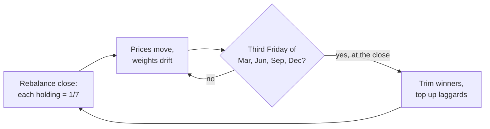

# EQ7 · AI Seven Equal Weight Index

A custom "pie" of seven AI-era leaders at equal weight, presented like a ticker in the iOS Stocks app and benchmarked against QQQ.

- **Page:** [claude.ai/artifact/Rq8TsijoqteX3qru8U9MkC](https://claude.ai/artifact/Rq8TsijoqteX3qru8U9MkC) (private until you share it)
- **On this site:** `static/eq7/index.html`, which Hugo serves at `/eq7/`. It also opens straight from disk.

| Ticker | Company | Role in the stack |
|---|---|---|
| NVDA | NVIDIA | Accelerators |
| TSM | TSMC | Foundry |
| ASML | ASML | Lithography |
| GOOGL | Alphabet | Models and cloud |
| AMZN | Amazon | Cloud |
| META | Meta | Models and apps |
| TSLA | Tesla | Autonomy and robotics |

## What the page does

- Quote header, the iOS range bar (1D 1W 1M 3M 6M YTD 1Y 2Y 5Y 10Y ALL) and the price chart. 1D uses 1-minute bars, 1W 15-minute, 1M hourly, then daily, then weekly from 5Y up.
- iOS chart gestures: drag one finger (or hover) to read a point. Use two fingers (or click and drag) to measure the change between two dates.
- **Compare with QQQ** switch: both lines are rebased to 0% at the start of the range, with the spread in points.
- **Log** toggle on 2Y and longer, so equal percentage moves get equal height. On ALL this is the honest view of a 99x run.
- Stats pages, a performance table vs QQQ (cumulative or annualized), holdings as watchlist rows with current drifted weights, and a page for each holding. Tap any row.
- **Rebalance** (Monthly / Quarterly / Annual / Never) and **Returns** (Price / Total return) switches recompute the whole index in the browser.

## Snapshot, Oct 30 2026 close

| | EQ7 | QQQ |
|---|---:|---:|
| Level | 9,901.86 (base 100) | 690.49 |
| Since May 18 2012 | +9,802% | +1,035% |
| CAGR | 37.4% | 18.3% |
| Max drawdown | −53.0% | −35.6% |
| Volatility, 1Y | 27.3% | 20.3% |
| Beta vs QQQ, 1Y | 1.20 | — |
| Past year | +11.55% | +10.29% |

EQ7 compounded about twice as fast as QQQ, with roughly 1.5x the drawdown. The return came with more risk, not instead of it.

## Methodology



The index holds units of each stock, like a fund holds shares:

```
at each rebalance close R:   units_i = (Level_R / 7) / Price_i(R)
on every other day t:        Level_t = Σ units_i × Price_i(t)
```

- **Base:** 100.00 at the May 18 2012 close, the first day all seven traded (Meta's IPO).
- **Rebalance date:** close of the third Friday of the scheduled months, or the trading day before it when that Friday is a holiday (Juneteenth 2026 moved June's to the 18th).
- **Price return** (default) leaves out dividends, matching QQQ's quoted price. Distributions over 10% of the share price count as capital returns and are reinvested so they don't read as losses. The only one is ASML's Nov 2012 capital return, about 15% of its price at the time. Providers such as S&P adjust price indexes for special dividends in a similar way.
- **Total return** reinvests every dividend at the ex-date close, for EQ7 and QQQ alike.
- **Intraday** levels price the units held going into the session against each stock's bars, which is how an ETF's intraday indicative value works. The 1D chart ends exactly on the official close.
- **Statistics:** beta, correlation and volatility use one year of daily returns. CAGR and max drawdown run from May 2012. EQ7's 52-week range uses closing levels.

## Rebalancing is a bet on mean reversion

Same seven stocks and start date, four schedules (price return, May 2012 to Oct 2026):

| Schedule | Level | CAGR | Max drawdown | Largest weight today | Rebalances |
|---|---:|---:|---:|---|---:|
| Monthly | 9,473.71 | 37.0% | −52.0% | TSLA 16.9% | 173 |
| **Quarterly** (default) | **9,901.86** | **37.4%** | **−53.0%** | TSLA 16.7% | 58 |
| Annual | 10,741.61 | 38.2% | −53.7% | ASML 19.1% | 14 |
| Never | 14,468.88 | 41.1% | −63.7% | NVDA 66.9% | 0 |
| QQQ | — | 18.3% | −35.6% | — | — |

Rebalancing sells what went up and buys what went down. That pays when leaders give back their gains, and it costs when one winner keeps compounding. NVDA compounded about 677x here, so every trim gave away some of that run. Never rebalancing earned the most, but by 2026 the "equal weight" basket was two-thirds one stock. Quarterly rebalancing keeps the equal-weight promise and gives up part of the right tail to do it.

## Data

- **Source:** Yahoo Finance's public chart endpoint. It supplies split-adjusted daily closes back to each IPO, dividends and splits, plus 1-minute, 15-minute and hourly bars for the latest session, week and month.
- **Checks:** Oct 30 closes for NVDA, GOOGL, META and TSM match Financial Modeling Prep to the cent. FMP's dividend history confirms NVDA's raise from $0.01 to $0.25 a quarter in 2026. Every daily move over 20% traces to a real earnings or news day. The only break in the calendar longer than a holiday weekend is the Hurricane Sandy closure (Oct 29–30 2012). An independent Python implementation (`build.py verify`) reproduces the page's level to 4 decimals.
- **Why a snapshot, not live:** the page can't fetch market data itself, and the FMP connector's current plan blocks quotes for ASML and QQQ. Without those two, neither EQ7 nor the comparison can be computed live.

## Refresh the data

```bash
python3 -I eq7/build.py all --raw "$(mktemp -d)"   # fetch, normalize, verify, build
```

This rewrites `eq7/data/snapshot.json` and `static/eq7/index.html`. Add `--fragment out.html` to also write the version without a document wrapper, which is what gets published as the artifact.

| File | What it is |
|---|---|
| `eq7/app.html` | Page template: layout, index engine, chart and interactions |
| `eq7/build.py` | Fetch, snapshot, Python verification and page build |
| `eq7/data/snapshot.json` | Compact price, dividend and intraday data the page embeds |
| `static/eq7/index.html` | Built page, served by Hugo at `/eq7/` |

## Caveats

- **Hindsight bias.** These seven were picked in 2026 knowing how they turned out. A basket chosen in 2012 would likely have held names that faded, so the backtest flatters the idea.
- No fees, taxes, spreads or rebalancing costs are modeled.
- EQ7 is a hypothetical index, not a fund you can buy.
