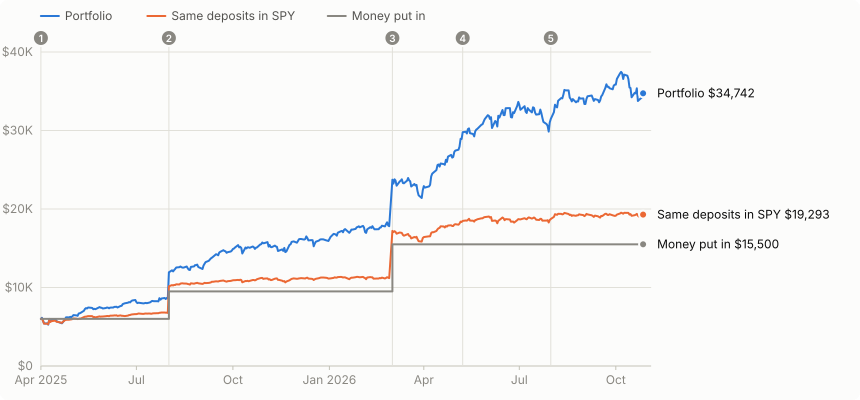
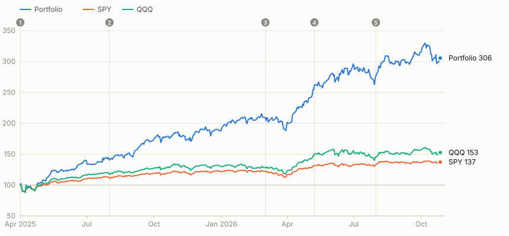
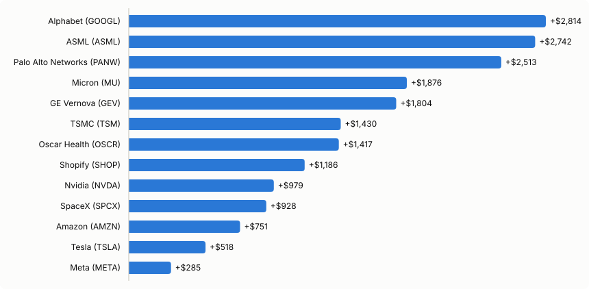
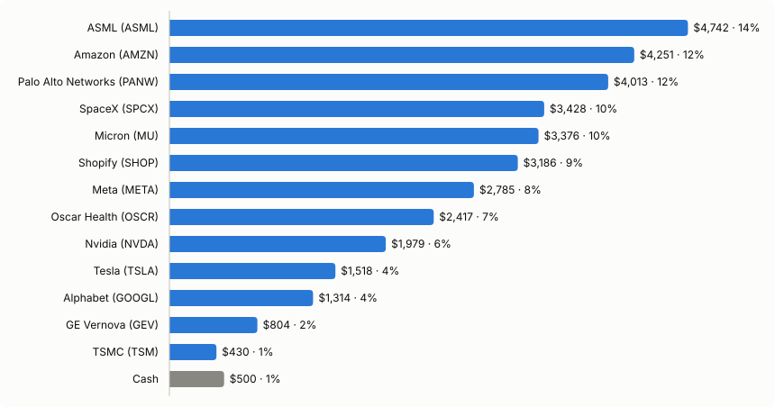

# Vibe portfolio

A small, unplanned stock portfolio: five rounds of buying and trimming between April 2025 and July 2026, with $15,500 of new money in total. This folder is its record. It holds a ledger of every trade, the daily closing prices behind it, and a script that rebuilds the numbers and charts below.

<!-- AUTO:asof -->
_Numbers as of the close on **27 Oct 2026**. Rebuild with `python3 portfolio/build.py`._
<!-- /AUTO:asof -->

## Scoreboard

The fair comparison is with the index you could have bought instead. **Same deposits in SPY** puts each deposit into the S&P 500 ETF on the same day and holds it. QQQ (Nasdaq-100) is the tech-heavy alternative.

<!-- AUTO:summary -->
| | Portfolio | Same deposits in SPY | Same deposits in QQQ |
|---|---:|---:|---:|
| Money put in | $15,500 | $15,500 | $15,500 |
| Value on 27 Oct 2026 | **$34,742** | $19,293 | $20,829 |
| Profit | **+$19,242** | +$3,793 | +$5,329 |
| Profit ÷ money put in | +124.1% | +24.5% | +34.4% |
| Money-weighted return (IRR, annualised) | +96.4% | +20.8% | +28.9% |
| Time-weighted return (since 1 Apr 2025) | +205.7% | +37.2% | +52.6% |

- **Cash on hand:** $500.00 · **Realized profit from trims:** +$4,666 · **Unrealized:** +$14,576
- **Peak value:** $37,469 on 6 Oct 2026 · **Worst drawdown (time-weighted):** -14.2% from 2 Apr 2025 to 8 Apr 2025
- **Risk:** annualised volatility 30.1% vs 16.9% for SPY · beta to SPY 1.50 · best day +13.9% (9 Apr 2025) · worst day -6.8% (4 Apr 2025)
- **Dividends:** not in the numbers above (all price-only, SPY and QQQ too). Holding these shares would have earned roughly $74 gross.
<!-- /AUTO:summary -->



The numbered circles mark the five trading rounds in the [timeline](#timeline).

### Three ways to measure return

| Measure | Question it answers | Use it for |
|---|---|---|
| Profit ÷ money put in | How many dollars did I make per dollar I put in? | The plain answer |
| Money-weighted (IRR) | What yearly rate did my actual money earn, given when each deposit arrived? | Your own experience |
| Time-weighted | How did the picks do, with the timing and size of deposits stripped out? | Comparing the picks with an index or a fund |

Time-weighted return is the growth of $1 that sat in the portfolio from day one. It chain-links the daily returns and removes each deposit on the day it lands. Fund managers are measured this way because they don't control when money arrives.



## Timeline

<!-- AUTO:timeline -->
| # | Trade date(s) | Money in | Sold | Bought | Cash after | What happened |
|---|---|---:|---:|---:|---:|---|
| 1 | 1 Apr 2025 | $6,000 | – | $6,000 | $0 | Buy TSLA $1,000; Buy NVDA $1,000; Buy TSM $1,000; Buy GOOGL $1,000; Buy GEV $1,000; Buy OSCR $1,000 |
| 2 | 1 Aug 2025 | $3,500 | – | $3,500 | $0 | Buy ASML $2,000; Buy GOOGL $1,500 |
| 3 | 2 Mar 2026 | $6,000 | $2,000 | $6,500 | $1,500 | Sell GEV $2,000; Buy AMZN $3,500; Buy PANW $1,500; Buy MU $1,500 |
| 4 | 8 May 2026 → 12 May 2026 | – | $6,000 | $2,000 | $5,500 | Sell GOOGL $4,000; Sell TSM $2,000; Buy SHOP $2,000 |
| 5 | 31 Jul 2026 | – | – | $5,000 | $500 | Buy SPCX $2,500; Buy META $2,500 |

<details><summary>Every fill, with the closing price used</summary>

| Date | Action | Ticker | Amount | Close used | Shares | Realized P&L |
|---|---|---|---:|---:|---:|---:|
| 2025-04-01 | Buy | TSLA | $1,000.00 | $268.46 | 3.7249 |  |
| 2025-04-01 | Buy | NVDA | $1,000.00 | $110.15 | 9.0785 |  |
| 2025-04-01 | Buy | TSM | $1,000.00 | $168.64 | 5.9298 |  |
| 2025-04-01 | Buy | GOOGL | $1,000.00 | $157.07 | 6.3666 |  |
| 2025-04-01 | Buy | GEV | $1,000.00 | $315.64 | 3.1682 |  |
| 2025-04-01 | Buy | OSCR | $1,000.00 | $12.97 | 77.1010 |  |
| 2025-08-01 | Buy | ASML | $2,000.00 | $689.82 | 2.8993 |  |
| 2025-08-01 | Buy | GOOGL | $1,500.00 | $189.13 | 7.9311 |  |
| 2026-03-02 | Sell | GEV | $2,000.00 | $881.18 | 2.2697 | +$1,284 |
| 2026-03-02 | Buy | AMZN | $3,500.00 | $208.39 | 16.7954 |  |
| 2026-03-02 | Buy | PANW | $1,500.00 | $150.15 | 9.9900 |  |
| 2026-03-02 | Buy | MU | $1,500.00 | $412.67 | 3.6349 |  |
| 2026-05-08 | Sell | GOOGL | $1,333.33 | $400.80 | 3.3267 | +$752 |
| 2026-05-08 | Sell | TSM | $666.67 | $411.68 | 1.6194 | +$394 |
| 2026-05-08 | Buy | SHOP | $666.67 | $110.41 | 6.0381 |  |
| 2026-05-11 | Sell | GOOGL | $1,333.33 | $388.64 | 3.4308 | +$733 |
| 2026-05-11 | Sell | TSM | $666.67 | $404.54 | 1.6480 | +$389 |
| 2026-05-11 | Buy | SHOP | $666.67 | $102.54 | 6.5015 |  |
| 2026-05-12 | Sell | GOOGL | $1,333.33 | $387.35 | 3.4422 | +$731 |
| 2026-05-12 | Sell | TSM | $666.67 | $397.28 | 1.6781 | +$384 |
| 2026-05-12 | Buy | SHOP | $666.67 | $99.84 | 6.6774 |  |
| 2026-07-31 | Buy | SPCX | $2,500.00 | $108.37 | 23.0691 |  |
| 2026-07-31 | Buy | META | $2,500.00 | $556.71 | 4.4907 |  |

</details>
<!-- /AUTO:timeline -->

Notes on each round (figures as of 27 Oct 2026):

1. **1 Apr 2025.** $1,000 into each of six names. The next afternoon brought the 2 April tariff announcement. The portfolio fell 14.2% in four sessions, its worst drawdown of the whole period. It then had its best day, +13.9%, on 9 April when the tariffs were paused.
2. **1 Aug 2025.** ASML and a second Google buy. By the end of July the portfolio was already 43% ahead on a time-weighted basis, against 13% for SPY.
3. **2 Mar 2026.** New money plus a $2,000 GE Vernova trim, put into Amazon, Palo Alto Networks and Micron, leaving $1,500 in cash. Palo Alto (+167%) and Micron (+125%) became two of the best buys in the book. The portfolio's second-worst drawdown (−12.6%) ran from 25 Feb to 30 Mar 2026, straddling this round.
4. **8–12 May 2026.** Trimmed $4,000 of Google and $2,000 of TSMC, bought $2,000 of Shopify, and kept the other $4,000 as cash.
5. **31 Jul 2026.** SpaceX and Meta, paid from cash, leaving $500. SpaceX had listed on 12 June at $160.95 and peaked at a $211.39 close on 16 June. It was bought at $108.37, within 0.1% of its lowest close since listing ($108.27 on 5 Aug). Meta was bought the day after an 8% one-day drop.

## Where the profit came from



All 13 positions are in profit. Realized and unrealized gains are counted together, so a trimmed holding like Google gets credit for what it already paid out.

## Where the money sits



<!-- AUTO:positions -->
| Holding | First bought | Put in | Taken out | Shares | Avg cost | Price | Value | Profit | Return on money put in | Weight |
|---|---|---:|---:|---:|---:|---:|---:|---:|---:|---:|
| Alphabet (GOOGL) | 2025-04-01 | $2,500 | $4,000 | 4.0980 | $174.85 | $320.58 | $1,314 | +$2,814 | +112.5% | 3.8% |
| ASML (ASML) | 2025-08-01 | $2,000 | – | 2.8993 | $689.82 | $1,635.57 | $4,742 | +$2,742 | +137.1% | 13.6% |
| Palo Alto Networks (PANW) | 2026-03-02 | $1,500 | – | 9.9900 | $150.15 | $401.70 | $4,013 | +$2,513 | +167.5% | 11.6% |
| Micron (MU) | 2026-03-02 | $1,500 | – | 3.6349 | $412.67 | $928.76 | $3,376 | +$1,876 | +125.1% | 9.7% |
| GE Vernova (GEV) | 2025-04-01 | $1,000 | $2,000 | 0.8985 | $315.64 | $895.08 | $804 | +$1,804 | +180.4% | 2.3% |
| TSMC (TSM) | 2025-04-01 | $1,000 | $2,000 | 0.9844 | $168.64 | $436.87 | $430 | +$1,430 | +143.0% | 1.2% |
| Oscar Health (OSCR) | 2025-04-01 | $1,000 | – | 77.1010 | $12.97 | $31.35 | $2,417 | +$1,417 | +141.7% | 7.0% |
| Shopify (SHOP) | 2026-05-08 | $2,000 | – | 19.2170 | $104.07 | $165.81 | $3,186 | +$1,186 | +59.3% | 9.2% |
| Nvidia (NVDA) | 2025-04-01 | $1,000 | – | 9.0785 | $110.15 | $217.94 | $1,979 | +$979 | +97.9% | 5.7% |
| SpaceX (SPCX) | 2026-07-31 | $2,500 | – | 23.0691 | $108.37 | $148.58 | $3,428 | +$928 | +37.1% | 9.9% |
| Amazon (AMZN) | 2026-03-02 | $3,500 | – | 16.7954 | $208.39 | $253.10 | $4,251 | +$751 | +21.5% | 12.2% |
| Tesla (TSLA) | 2025-04-01 | $1,000 | – | 3.7249 | $268.46 | $407.46 | $1,518 | +$518 | +51.8% | 4.4% |
| Meta (META) | 2026-07-31 | $2,500 | – | 4.4907 | $556.71 | $620.19 | $2,785 | +$285 | +11.4% | 8.0% |
| Cash | | | | | | | $500 | | | 1.4% |
| **Total** | | **$23,000** | **$8,000** | | | | **$34,742** | **+$19,242** | | 100% |
<!-- /AUTO:positions -->

"Put in" is everything spent buying the stock. "Taken out" is what the trims raised. Profit is realized plus unrealized.

## Were the trims good calls?

This compares each sale with simply keeping those exact shares. A positive number means selling beat holding.

<!-- AUTO:sells -->
| Sold | When | Shares | Avg price | Proceeds | Realized profit | Price now | Those shares today | Selling vs holding |
|---|---|---:|---:|---:|---:|---:|---:|---:|
| GE Vernova (GEV) | 2026-03-02 | 2.2697 | $881.18 | $2,000 | +$1,284 | $895.08 | $2,032 | -$32 |
| Alphabet (GOOGL) | 2026-05-08 to 2026-05-12 | 10.1996 | $392.17 | $4,000 | +$2,217 | $320.58 | $3,270 | +$730 |
| TSMC (TSM) | 2026-05-08 to 2026-05-12 | 4.9454 | $404.41 | $2,000 | +$1,166 | $436.87 | $2,161 | -$161 |
| **All trims** | | | | **$8,000** | **+$4,666** | | **$7,462** | **+$538** |
<!-- /AUTO:sells -->

This leaves out what the cash did next. The May trims paid for Shopify (+59%) and, with cash already on hand, for SpaceX and Meta in July.

## The read

Figures as of 27 Oct 2026.

- **It beat the index by a wide margin.** The same deposits in SPY would be worth $19,293. The portfolio is worth $34,742, which is $15,449 more. Time-weighted, $100 became $306 against $137 in SPY and $153 in QQQ.
- **The win came from a theme more than from any single stock.** Profit is spread out: the biggest contributor (Google) is 15% of it and the top three are 42%. Semiconductors (Nvidia, TSMC, ASML, Micron) are 30% of today's value. Most of the rest (Alphabet, Amazon, Meta, GE Vernova) is also tied to AI data-centre spending. The portfolio moved about 1.5× as much as the S&P 500 and was nearly twice as volatile (30% vs 17%). That extra risk paid off because this period rewarded exactly that bet.
- **Thirteen out of thirteen winners over 19 months is a small sample from one market regime.** It shows the theme worked. It can't yet tell skill from a rising tide. The test is how the portfolio holds up in a period when AI hardware falls out of favour, and the beta of 1.5 says it would likely fall faster than the index in that case.
- **The trims locked in $4,666 of profit and are $538 ahead of holding.** Nearly all of that is Google, which is 18% below the average price it was sold at. The GE Vernova and TSMC trims have cost a little so far.
- **It is 7% below its 6 Oct 2026 peak of $37,469.**

## Method and assumptions

What the original notes didn't say, and how this record fills each gap:

| Gap in the notes | Assumption made here | To change it |
|---|---|---|
| Exact fill prices | Every trade fills at that day's **closing price** | Put your broker's actual dates in `ledger.csv` |
| "March 1st 2026" was a Sunday | Trades fill on **Mon 2 Mar 2026** | Edit the date |
| "May 8th–May 12th" | Each of the three orders is **split evenly** over 8, 11 and 12 May (three trading days) | Set one date per row and clear `date_end` |
| "SELL GE Vernova 2k" etc. | **Partial sales** of exactly that dollar amount. This leaves 0.90 GEV, 4.10 GOOGL and 0.98 TSM shares still held | If you sold out completely, change `amount_usd` to the full position value |
| "March 1st 2026 6k" | $6,000 of **new money**. With the $2,000 GEV sale that covers $6,500 of buys and leaves $1,500 cash. The May trims add $4,000 more, and the July buys spend $5,000, leaving **$500 cash** today | Edit the `DEPOSIT` rows |
| "Spacex" | **SPCX** on Nasdaq, which began trading 12 June 2026 | n/a |
| "Google" | **GOOGL** (Class A) | Use GOOG if that's the line you hold |
| "Tsmc", "ASML" | The US-listed ADRs **TSM** and **ASML** | n/a |

Also:

- **Fractional shares**, no fees, no FX, no tax. Cost basis is average cost.
- Returns are **price-only**, using split-adjusted closes that are not dividend-adjusted. SPY and QQQ are measured the same way, so the comparison is like for like. The dividend estimate above is shares held before each ex-date multiplied by the gross dividend.
- No stock splits happened in any of these names during the period.
- Within a day, deposits are applied first, then sells, then buys. The build stops with an error if a buy ever needs more cash than is on hand.

## Data sources

Prices come from **Financial Modeling Prep (FMP)** wherever the FMP plan covers the symbol. The plan blocks daily history for GEV, OSCR, ASML, PANW, MU, SPCX and QQQ, so those come from **Yahoo Finance's** chart API, as does every date FMP didn't return. Checks run before using the Yahoo data:

- On the 2,355 ticker-days both sources cover (NVDA, TSLA, TSM, GOOGL, AMZN, META, SHOP, SPY), the closes match to the cent, except 4 TSM days that differ by 0.06% or less.
- For the Yahoo-only names, FMP's company profiles (which the plan does allow) give the 27 Oct 2026 price. It matches Yahoo exactly for all six stocks, and every Yahoo close in the past year sits inside FMP's 52-week trading range.

<!-- AUTO:sources -->
| Ticker | Source | From | To | Trading days |
|---|---|---|---|---:|
| AMZN | FMP | 2026-02-25 | 2026-10-27 | 170 |
| AMZN | Yahoo | 2025-04-01 | 2026-02-24 | 226 |
| ASML | Yahoo | 2025-04-01 | 2026-10-27 | 396 |
| GEV | Yahoo | 2025-04-01 | 2026-10-27 | 396 |
| GOOGL | FMP | 2025-04-01 | 2026-10-27 | 396 |
| META | FMP | 2026-07-27 | 2026-10-27 | 66 |
| META | Yahoo | 2025-04-01 | 2026-07-24 | 330 |
| MU | Yahoo | 2025-04-01 | 2026-10-27 | 396 |
| NVDA | FMP | 2025-04-01 | 2026-10-27 | 396 |
| OSCR | Yahoo | 2025-04-01 | 2026-10-27 | 396 |
| PANW | Yahoo | 2025-04-01 | 2026-10-27 | 396 |
| QQQ | Yahoo | 2025-04-01 | 2026-10-27 | 396 |
| SHOP | FMP | 2025-04-01 | 2026-10-27 | 126 |
| SHOP | Yahoo | 2025-04-04 | 2026-05-01 | 270 |
| SPCX | Yahoo | 2026-06-12 | 2026-10-27 | 95 |
| SPY | FMP | 2025-04-01 | 2026-10-27 | 396 |
| TSLA | FMP | 2025-04-01 | 2026-10-27 | 396 |
| TSM | FMP | 2025-04-01 | 2026-10-27 | 396 |
<!-- /AUTO:sources -->

## Files and how to update

| File | What it is |
|---|---|
| `ledger.csv` | **The source of truth.** One row per deposit, buy or sell, in dollars. `date_end` spreads a row over several days. |
| `data/prices.csv` | Daily closes, one column per ticker |
| `data/price_sources.csv` | Which source supplied each ticker's closes, and for which dates |
| `data/dividends.csv` | Ex-dates and amounts, used only for the dividend estimate |
| `build.py` | Replays the ledger. Writes `out/` and `charts/`, and rewrites the auto-generated tables in this README |
| `fetch_prices.py` | Refreshes `data/` from FMP (with `FMP_API_KEY` set), falling back to Yahoo |
| `out/history.csv` | Daily money in, cash, holdings, total, P&L, return indexes and benchmark values |
| `out/trades.csv`, `out/rounds.csv` | Every fill with the price used, and the five rounds summarised |
| `out/positions.csv`, `out/sells.csv`, `out/summary.json` | The tables and headline numbers above |

To log a new trade, add a row to `ledger.csv`, then run:

```sh
FMP_API_KEY=your_key python3 portfolio/fetch_prices.py   # optional: refresh prices
python3 portfolio/build.py                                # rebuild numbers, charts and tables
```

Only the standard library is needed. The tables between the `AUTO` markers are regenerated each run. The rest of this page, including the dated figures in the notes and "The read", is hand-written and goes stale as prices move.
