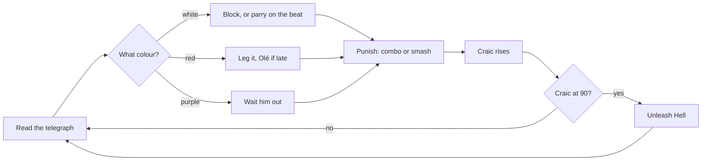
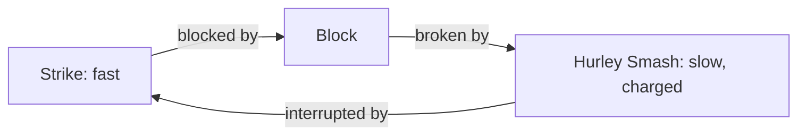
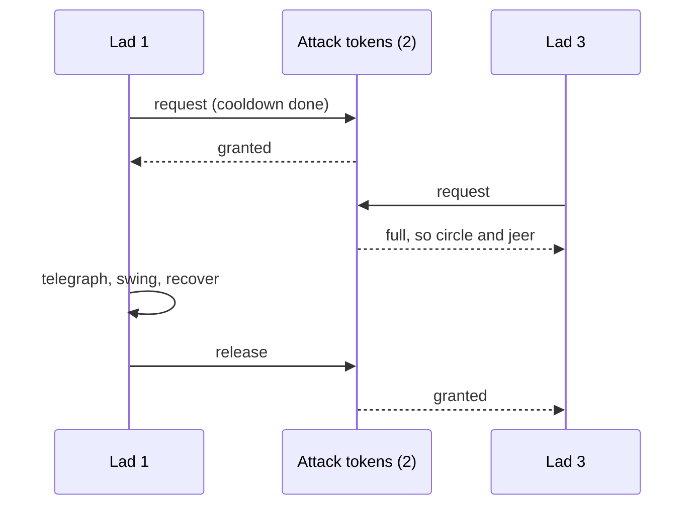
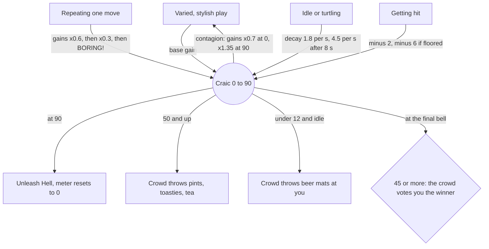
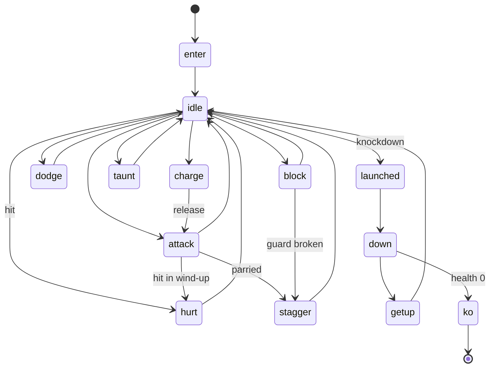

# Stout & Honour: design notes

How the game works, from first principles. Every number below lives in `js/data.js` or `js/game.js` and can be tuned there.

## 1. The premise in one table

The film's arena maps neatly onto a pub, because both are places where a crowd gathers to watch a contest and decides together what it thinks.

| Arena | Pub |
|---|---|
| The Colosseum | The Colosseum Bar & Lounge, est. A.D. 180 |
| The emperor's thumb | The landlord behind the bar giving a thumbs up or down |
| Gladius and shield | Hurley and bodhrán |
| "Win the crowd" | The **craic meter**, which maxes out at ninety |
| The Spaniard | The Kerryman |
| Zucchabar | A back room just outside Mullingar (the name already has "bar" in it) |
| Chariots at Carthage | A stag party in shopping trolleys |
| Tigers through trapdoors | The landlord's Jack Russell, Tiger, through the cellar hatches |
| The Praetorian Guard | The bouncers |
| The wheat field | A barley field, where every pint settles instantly |

## 2. The core loop



A fight is a stream of small decisions made from information, the telegraph, under time pressure. Everything else exists to make those decisions readable on a 6-inch screen and to reward making them well.

## 3. Combat is a mixed-strategy game

No single action wins, so the player has to read and mix. There are two interlocking triangles.

**Defending** (rows are your choice, columns are what the lad throws):

|  | White swing | Red swing | Purple stance |
|---|---|---|---|
| **Block** | Safe. Perfect timing = **parry** (stagger, 1.5× counter damage) | You get hit | Wasted time |
| **Leg it** | Safe, costs wind | Safe. Late = **Olé** (+craic, slow-mo) | Wasted wind |
| **Strike** | Interrupts *if* you land first in his wind-up | Bosses have armour, so you eat it | **Countered** |

**Attacking** (against a lad who blocks):



Two costs stop any one answer from dominating:

- **Wind (stamina).** Dodges cost 20, blocked hits cost 2× their damage, and a smash costs 12. Run out and you are "winded": guard broken, stunned. Spamming defence is self-limiting.
- **The crowd.** Repeating the same action decays its craic reward (see §5), so even a "safe" loop is a losing loop over a whole bout.

### Frame data (seconds, Pint of Plain difficulty)

| Move | Start-up | Active | Recovery | Notes |
|---|---|---|---|---|
| Jab, swipe | 0.075 / 0.085 | 0.08 / 0.09 | 0.17 / 0.19 | Cancel into the next hit after active |
| Hurley swing (3rd hit) | 0.13 | 0.10 | 0.30 | Knockdown, hits several lads |
| Hurley Smash | hold 0.24 to begin, 0.7 to full | 0.12 | 0.38 | Guard break; full charge adds +10 dmg and a ground slam |
| Leg it | — | 0.27 invincible | 0.32 total | Direction from the stick, backstep if neutral |
| Parry window | 0.18 from pressing BLOCK | | | 0.24 on Shandy, 0.14 on Poitín |
| Lad's jab (white) | 0.42 | 0.08 | 0.36 | Human visual reaction is ~0.2–0.25 s, so this is reactable |
| Lad's haymaker (red) | 0.80 | 0.10 | 0.60 | Long, loud, glowing; teaches the dodge |

Telegraph durations scale ×1.28 on Shandy and ×0.84 on Poitín.

## 4. The AI learns your habits (fictitious play)

Enemies keep a running estimate of how *you* defend, `G.obs`, and best-respond to it by reweighting their move mix. It is the classic **fictitious play** model from game theory: assume the opponent is playing their historical average, then pick the counter.

```
obs.block += 0.15 * (1 - obs.block)    on every hit you block   (0.2 on a parry)
obs.dodge += 0.20 * (1 - obs.dodge)    on every Olé
obs.aggro += 0.30 * (1 - obs.aggro)    when you swing into a counter stance
obs.block, obs.dodge *= 0.92           whenever you get hit

weight(unblockable move) *= 1 + 1.6 * obs.block
weight(quick white move) *= 1 + 0.9 * obs.dodge
weight(counter stance)   *= 0.4 + 1.8 * obs.aggro
```

Turtle behind the bodhrán and you see more red. Dodge everything and you see quick white jabs that punish dodge recovery. Swing wildly at Commodus and he sits in his counter stance. Predictable play gets exploited, so the game nudges you toward the mixed strategy, which is the equilibrium of a rock-paper-scissors game. Commodus also **feints**: if you dodge his red lunge early, he cancels into a quick jab while you are still recovering.

### Attack tokens: why you are never mobbed unfairly

Only a few lads may attack at once (1 on Shandy, 2 on Pint of Plain, 3 on Poitín). The rest circle at a distance, spread out in depth, and jeer. A lad who can't reach you within 3.4 s hands his token back.



Ranged lads (darts, turf) have their own cap, so you never face more than a couple of projectiles in flight.

## 5. The crowd is a mimetic system

The craic meter is the game's economy. It is built from feedback loops, and its central rule is borrowed from René Girard: a crowd wants what the fella beside it wants, so **excitement is contagious**.



- **Positive feedback (contagion)** makes a good run snowball, which feels great and rewards momentum.
- **Negative feedback** (decay, the repetition penalty, getting hit, and the special emptying the meter) keeps the snowball from running away.
- **Variety bonus.** If the last four actions were all different (say jab → parry → smash → Olé), gains are ×1.35. The crowd pays for spectacle.
- **The crowd is a win condition.** When time is called, a crowd at 45 or more craic wins you the bout. Style and survival point the same way, so playing to the crowd is never a trap.

| Action | Base craic |
|---|---|
| Jab / swipe / 3rd hit | 1.0 / 1.15 / 2.5 |
| Hurley Smash | 3.5 (+2.5 at full charge) |
| Parry | 10 |
| Return a dart | 11 |
| Olé (last-second dodge) | 8 |
| Knock-out | 4 (boss: 22) |
| Trolley flattens a lad | 8 |
| Taunt | 4 + 6 per lad on the floor (+8 within 3.5 s of a KO); ×0.35 if you taunted within 6 s, ×0.6 if someone is close |

## 6. Risk and reward valves

Each optional action is a small bet with a capped downside and an open upside (convexity, in Nassim Taleb's terms):

- **Taunt** ("Are you not entertained?!"): one second with your arms in the air. Done right after a knockdown it is the fastest way to fill the meter. Done in a crowd, you get punched and "the crowd laughs" (−5).
- **Hurley Smash:** slow to charge, and lads with a free token will punish the wind-up. It is the only way through a bouncer's guard.
- **Pints:** a happy crowd throws them in, but they need 1.5 s to settle (a two-part pour) and they land a few steps away. A hurt lad will walk over and drink yours. Hit him mid-sip and the pint is spilled.
- **Olé:** dodging *late* is worth more than dodging early, so the reward sits right next to the risk.
- **Vengeance:** under 25 % health, your hits land 30 % harder.

## 7. Built for a phone

- **Floating joystick.** Touch anywhere on the left half and that point becomes the stick's centre. If you drag past the rim, the base follows your thumb, so you never lose it.
- **Big, forgiving buttons.** A touch goes to the nearest button within 52 px of its edge. The cluster is shaped to the right thumb's arc. Multi-touch means you can move and strike at once.
- **Auto-aim and magnetism.** Attacks turn you toward the nearest lad, line up your depth, and lunge you into range. Touch sticks are imprecise; the game compensates instead of punishing.
- **Input buffering.** Presses are remembered for 0.2 s, so mashing during recovery chains the next hit cleanly.
- **Readability.** White, red, yellow and purple telegraphs with "!" above heads, red floor markers under unblockables, flashing lanes before trolleys, landing rings under thrown turf, and arrows at the screen edge for anyone off-camera.
- **Game feel.** Hitstop (30–90 ms freezes on impact), screen shake, slow-motion on parries, Olés and final KOs, and a camera that zooms in on the last man down.
- **Landscape with a fallback.** In portrait the game pauses behind a "turn the phone sideways" card. Safe-area insets keep the HUD clear of the notch and the home bar.

## 8. One mechanic per bout

The story is also the tutorial. Each bout adds one idea.

| Bout | Setting | New idea |
|---|---|---|
| I · The Battle of Germania | Stag party in the lounge | Move, strike, block, dodge. The meter is filled for you on the last round to teach **Unleash Hell** |
| II · Zucchabar | Proximo's back room | The craic meter and the taunt |
| III · The Pairs | Back room | Bouncers (smash their guard), darts (parry them back), turf (watch the landing ring) |
| IV · The Battle of Carthage | The Colosseum Bar | Trolley chariots charging along lit lanes |
| V · Tigris of Galway | The Colosseum Bar | First boss: armoured wind-ups, cellar hatches. Then your choice: **spare him or bar him** |
| VI · The Praetorian Guard | The Colosseum Bar | Everything at once |
| VII · Commodus | Closing time | You start at 62 % health from the spiked pint, with wobbly controls. Feints, counter stance, crisps in your eyes. If you spared Tigris, he throws you a pint |

**The Lock-In** is endless: a budget of "trouble points" that grows each round (`2 + 1.25 × round`) buys a random mix of lads. Tigris turns up every fifth round and Commodus every tenth, trolleys from round 3, hatches from round 6, and the Guards (shh) pass by now and again.

## 9. The fighter state machine



## 10. How it is made

- **No assets.** Characters are a 2.5D cartoon rig: the torso and arms use forward kinematics, and the legs use two-bone IK so feet stay planted when the hips drop. Attacks blend between wind-up and strike keyframes, and looks (jerseys, Viking helmets, hurling helmets with face cages, shamrock wreaths) are layered on top. The pub is painted once into an off-screen canvas, and the fire, lamps, band and crowd animate on top of it.
- **No audio files.** SFX are synthesised with Web Audio: a bodhrán thump for blocks, bell partials for last orders, filtered noise for crowd roars and chants. Four original tunes (a jig, a reel, a boss reel in E dorian and a slow air) are written in a tiny ABC-style notation and played by a lookahead sequencer with tin whistle, fiddle, bouzouki strums and bodhrán. On iPhone the announcer uses the system's Irish English voice when it has one.
- **Deterministic core.** A fixed 60 Hz simulation step, with hitstop and slow-motion applied to simulation time only.
- **Installable.** A web app manifest, home-screen icons and a network-first service worker.

## 11. Nods, for the record

**From the film:** the title (a play on "strength and honour"), the tagline (life and eternity become the pub and the parish), the "Are you not entertained?" taunt, the Unleash Hell special, the crowd chant (Kerryman! for Spaniard!), Zucchabar, Carthage, Tigris, the thumbs verdict, "Am I not merciful?", "terribly vexed", the spiked final duel, and the barley field.

**From the pub:** last orders and the bell, the round system ("It's your round", "Same again", "One for the road"), the lock-in, being barred, Fir and Mná on the jacks doors, the snug, the trad session, the two-part pour, the toasted special, a cup of tae, the turnip jack-o'-lantern on the windowsill (Samhain did it first), a chalkboard that says NO SINGING, the Guards, Olé olé from Italia '90, the Celtic Tiger, culchies, the Big Smoke, and Ballygobackwards.
